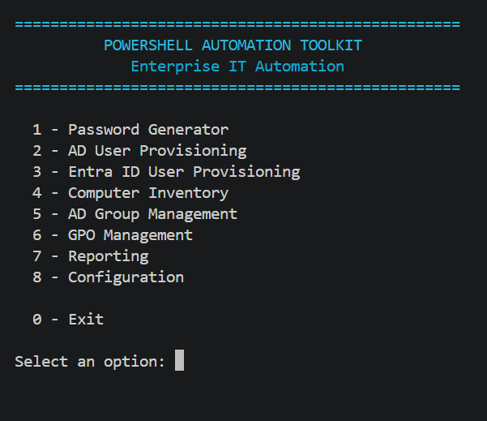

# PowerShell Automation Toolkit
## Enterprise IT Automation



A modular PowerShell automation toolkit designed to automate common IT infrastructure and administration tasks across on-premises Active Directory, Microsoft Entra ID, endpoint inventory, Group Policy, reporting, and configuration management.

The project is structured to be reusable across different environments through external configuration files, Simulation Mode, validation, error handling, and automated tests.

---

## Project Overview

The goal of this project is to transform repetitive IT administration activities into controlled, repeatable, and auditable PowerShell workflows.

The toolkit is organized into independent modules and a central interface:
- **01 - Password Generator**
- **02 - Configuration**
- **03 - AD User Provisioning**
- **04 - Entra ID User Provisioning**
- **05 - Computer Inventory**
- **06 - AD Group Management**
- **07 - GPO Management**
- **08 - Reporting**
- **09 - Interface & Toolkit Launcher**
- **10 - Interface V2**: alternative command-line interface
- **11 - Interface GUI**: WPF graphical interface
- **Core**: reusable audit, computer, group, and user components

The modules can be used independently or launched through the central interface.

---

## Architecture

```text
                    POWERSHELL AUTOMATION TOOLKIT
                                |
                                v
                    09 - INTERFACE & LAUNCHER
                                |
       +--------+--------+------+-------+--------+--------+
       v        v        v      v       v        v        v
      01       02       03     04      05       06       07
   Password  Config     AD    Entra  Inventory Groups    GPO
   Generator          Users    ID
                                |
                                v
                            08 - Reporting
```

---

## Modules

### 01 - Password Generator

Generates secure random passwords using configurable rules.

Features:
- Configurable password length
- Cryptographically secure random generation
- Configurable special characters
- Validation of password requirements

### 02 - Configuration

Central configuration validation for the toolkit.

Features:
- Configuration file validation
- Prefix validation
- Password character quantity validation
- Date format validation
- Special character validation
- Separation between public example configuration and local configuration

### 03 - AD User Provisioning

Automates user provisioning in on-premises Active Directory.

Features:
- User input validation
- SAM account name generation
- Accent removal
- Duplicate detection
- Configurable user types
- Employee, contractor, and intern formats
- UPN generation
- Long-name handling
- Simulation Mode
- Active Directory connectivity validation
- Controlled user creation

### 04 - Entra ID User Provisioning

Automates user provisioning in Microsoft Entra ID using Microsoft Graph PowerShell.

Features:
- Microsoft Graph authentication
- Tenant validation
- User input validation
- UPN generation
- Duplicate detection
- Simulation Mode
- Secure password input
- Temporary handling of password data
- Real user provisioning
- Post-provisioning validation
- Least-privilege-oriented permissions

### 05 - Computer Inventory

Collects hardware, operating system, processor, memory, disk, network, and BitLocker information.

Features:
- Computer system inventory
- Operating system information
- Processor information
- RAM information
- Disk information
- Network information
- BitLocker status
- Configurable collection categories
- JSON export
- CSV export
- Error handling for unavailable components

### 06 - AD Group Management

Automates common Active Directory group management tasks.

Features:
- Group existence validation
- Group creation
- Add members
- Remove members
- List members
- Group configuration
- Simulation Mode
- Active Directory connectivity validation
- Configurable operation controls

### 07 - GPO Management

Provides controlled automation for Group Policy administration.

Features:
- GPO existence validation
- GPO listing
- GPO creation
- GPO link inspection
- Simulation Mode
- Active Directory / Group Policy connectivity validation
- Configurable operation controls

### 08 - Reporting

Aggregates information generated by the other modules into centralized reports.

Features:
- Configurable data sources
- JSON and CSV input
- Source filtering
- Summary generation
- Detailed dataset generation
- JSON report export
- CSV summary export
- Error handling per source file
- Relative and absolute path support

### 09 - Interface & Toolkit Launcher

Central command-line interface for accessing the toolkit modules.

Features:
- Centralized menu
- Access to modules 01–08
- Configuration validation access
- Module path validation
- Centralized error handling
- Interactive execution flow

Example menu:

```text
==================================================
          POWERSHELL AUTOMATION TOOLKIT
             Enterprise IT Automation
==================================================
  1 - Password Generator
  2 - AD User Provisioning
  3 - Entra ID User Provisioning
  4 - Computer Inventory
  5 - AD Group Management
  6 - GPO Management
  7 - Reporting
  8 - Configuration

  0 - Exit
```

---

## Security & Validation

Security and controlled execution are core design principles of the project.

The toolkit includes:
- Simulation Mode for modules that can perform real environment changes
- Configuration validation
- Input validation
- Duplicate detection
- Explicit Active Directory server configuration
- No hard-coded production credentials
- No hard-coded tenant credentials
- Local configuration files excluded from the public repository
- Example configuration files for public use
- Secure password input for Entra ID provisioning
- Temporary handling and cleanup of password data
- Controlled error handling

The public repository is designed to contain examples and source code without exposing environment-specific credentials, tenant identifiers, or local configuration data.

---

## Automated Testing

The project contains 19 unique automated test scripts covering the numbered modules, interfaces, and reusable Core components.

| Test area | Scripts | Tests passed |
|---|---:|---:|
| Modules 01–09 | 9 | 190 |
| Interfaces 10–11 | 2 | 102 |
| Core components | 8 | 404 |
| **Total** | **19** | **696** |

The recorded regression run completed all 19 scripts with exit code 0 and no reported test failures. The three test scripts for Entra ID provisioning, GPO management, and reporting were also updated to return exit code 1 when their failure counter is greater than zero. Controlled failure tests confirmed this behavior.

A subsequent local validation session executed 20 test runs covering 19 unique test scripts. All 695 tests reported across those runs passed, with the Interface test executed twice. This run is separate from the historical regression result of 696 tests shown above. Automated tests do not replace integration, security, or acceptance testing in a real environment.

Additional validation performed on October 21, 2026:

- All 292 tests passed across the 11 numbered module test scripts executed in this validation pass.
- All 356 tests passed across seven official Core test scripts executed in this validation pass.
- A separate isolated Computer Core diagnostic passed 20/20 checks using mocked AD/CIM data. This is supplemental validation and is not counted as an official test script.
- A supplemental Computer Core test draft was reviewed on October 22, 2026. Its AD/CIM mocks are defined inside the module scope, while later calls to `Get-ComputerCimInfo` and `Get-ComputerInventory` occur outside that scope. Therefore, the draft is not confirmed to be fully isolated and its reported 49/49 assertions are not counted as official isolated test results.
- These results come from separate executions and must not be combined with the historical regression totals above as though they were one regression run.
- The original Computer Core test was not rerun in this pass because it can query real Active Directory and CIM services.

These results document the latest validation performed; they do not replace live integration, security, or acceptance testing.

Some Core tests reported that a default Active Directory server with Active Directory Web Services could not be found. Therefore, successful test results must not be interpreted as proof of live Active Directory, Entra ID, or Group Policy operations.

The GUI test suite validates structure and wiring; it is not a full end-to-end test of real administrative operations.

---

## Simulation Mode

Simulation Mode allows administrative workflows to be demonstrated and tested without making real changes to the target environment.

```text
Simulation Mode: ENABLED
No changes will be made to Active Directory.
```

Useful for development, testing, demonstrations, training, interviews, and customer presentations.

Always review each module's configuration and implementation before executing operations against a real environment.

---

## Configuration

Environment-specific configuration is kept outside the public source where appropriate.

Example files use neutral values such as:

```text
example.local
example.onmicrosoft.com
EMP
```

Local configuration files containing environment-specific values are excluded through `.gitignore`. Commit example configuration files, not local configuration files containing environment-specific settings.

### Computer Inventory configuration

Before running the Computer Inventory module in a fresh clone, create a local configuration file from the example:

```powershell
if (-not (Test-Path ".\05-Computer-Inventory\Inventory-Configuration.json")) {
    Copy-Item ".\05-Computer-Inventory\Inventory-Configuration.example.json" ".\05-Computer-Inventory\Inventory-Configuration.json"
}
```

This command creates the local configuration only if it does not already exist. It will not overwrite existing local settings.

The example configuration sets `SimulationMode` to `true` by default. Keep simulation enabled while reviewing the module and validating its behavior. Real inventory collection may query the target computer and access information that depends on the operating system and permissions.

The local `05-Computer-Inventory/Inventory-Configuration.json` file is excluded from version control. Only `Inventory-Configuration.example.json` should be committed to the public repository.

### Active Directory user provisioning configuration

The AD User Provisioning module uses a local `AD-Configuration.json` file. When setting up a fresh clone, create it from `AD-Configuration.example.json` only if the local file does not already exist:

```powershell
if (-not (Test-Path ".\03-AD-User-Provisioning\AD-Configuration.json")) {
    Copy-Item ".\03-AD-User-Provisioning\AD-Configuration.example.json" ".\03-AD-User-Provisioning\AD-Configuration.json"
}
```

Review the configuration and keep `SimulationMode` enabled while testing. Do not commit local domain, server, OU, or other environment-specific settings.

### AD Group Management, GPO Management, and Reporting configuration

Create each local configuration from its example when the local file does not already exist:

```powershell
$configuracoes = @(
    @{
        Example = ".\06-AD-Group-Management\Group-Configuration.example.json"
        Local   = ".\06-AD-Group-Management\Group-Configuration.json"
    },
    @{
        Example = ".\07-GPO-Management\GPO-Configuration.example.json"
        Local   = ".\07-GPO-Management\GPO-Configuration.json"
    },
    @{
        Example = ".\08-Reporting\Reporting-Configuration.example.json"
        Local   = ".\08-Reporting\Reporting-Configuration.json"
    }
)

foreach ($config in $configuracoes) {
    if (-not (Test-Path -LiteralPath $config.Local)) {
        if (-not (Test-Path -LiteralPath $config.Example)) {
            throw "Example configuration not found: $($config.Example)"
        }

        Copy-Item -LiteralPath $config.Example -Destination $config.Local
        Write-Host "Created: $($config.Local)"
    }
    else {
        Write-Host "Preserved existing configuration: $($config.Local)"
    }
}
```

Review each local configuration before running its module. Keep `SimulationMode` enabled during initial validation. Configure domain controllers, target domains, report sources, paths, and permissions only for your authorized environment. The examples are starting points and must be checked against the module implementation before use.

The local `Group-Configuration.json`, `GPO-Configuration.json`, and `Reporting-Configuration.json` files are excluded from version control. Commit their `.example.json` counterparts, not environment-specific local configurations.

---

## Prerequisites and Dependencies

### General requirements

- Windows environment for modules that rely on Windows-specific administration features.
- PowerShell 7 or later for the toolkit's documented baseline. Some Windows administration modules may require Windows PowerShell compatibility or a supported Windows environment.
- Git, if cloning or managing the repository from source.
- Appropriate permissions and connectivity for the target environment when running real operations.

### Module-specific dependencies

| Module | Dependency / requirement |
|---|---|
| 01 - Password Generator | PowerShell runtime; no additional external module identified |
| 02 - Configuration | PowerShell runtime; JSON support |
| 03 - AD User Provisioning | Active Directory PowerShell module (`ActiveDirectory`); domain connectivity and suitable permissions for real provisioning |
| 04 - Entra ID User Provisioning | Microsoft Graph PowerShell SDK, including `Microsoft.Graph.Users` and authentication support; valid Entra tenant, sign-in, required permissions, and network access for real operations |
| 05 - Computer Inventory | Windows CIM/WMI and access to the target computer; BitLocker information depends on OS and permissions |
| 06 - AD Group Management | Active Directory PowerShell module (`ActiveDirectory`); domain connectivity and suitable permissions for real group operations |
| 07 - GPO Management | Group Policy PowerShell module (`GroupPolicy`); domain connectivity and suitable permissions for real GPO operations |
| 08 - Reporting | PowerShell runtime; JSON/CSV data files |
| 09 - Interface & Toolkit Launcher | PowerShell runtime and project files for the modules being launched |
| 10 - Interface V2 | PowerShell runtime and the modules used by selected actions |
| 11 - Interface GUI | Supported Windows environment, PowerShell, WPF, and project files |
| Core | Dependencies vary by component; Active Directory operations require the relevant module, connectivity, and permissions |

### Installing Microsoft Graph PowerShell modules

Run in a PowerShell session with access to the PowerShell Gallery:

```powershell
Install-Module Microsoft.Graph.Authentication -Scope CurrentUser
Install-Module Microsoft.Graph.Users -Scope CurrentUser
```

For real Entra ID operations, authenticate to the intended tenant with the permissions required by the operation. Simulation tests do not establish that tenant authentication or real provisioning has been validated.

### Active Directory and Group Policy modules

The `ActiveDirectory` and `GroupPolicy` modules are generally provided through Remote Server Administration Tools (RSAT) on supported Windows environments. Availability depends on the Windows edition, installed administration tools, and target environment.

Check whether the modules are available:

```powershell
Get-Module -ListAvailable ActiveDirectory, GroupPolicy
```

Install or enable the appropriate RSAT components using the supported method for the Windows version and environment. Domain connectivity and authorized permissions are required for real changes.

> **Important:** Simulation Mode and passing automated tests do not guarantee production readiness. Validate configuration, permissions, connectivity, and expected behavior in a controlled environment before performing real operations.

---

## Technologies

- PowerShell 7+
- Windows PowerShell modules where required
- Active Directory PowerShell module
- Microsoft Graph PowerShell SDK
- GroupPolicy PowerShell module
- CIM / WMI
- JSON and CSV
- Git and GitHub

---

## Project Structure

The repository is organized into numbered modules, two additional interfaces, and reusable Core components.

```text
PowerShell-Automation/
├── 01-Password-Generator/
├── 02-Configuration/
├── 03-AD-User-Provisioning/
├── 04-Entra-ID-User-Provisioning/
├── 05-Computer-Inventory/
├── 06-AD-Group-Management/
├── 07-GPO-Management/
├── 08-Reporting/
├── 09-Interface/
├── 10-Interface-V2/
├── 11-Interface-GUI/
├── Core/
│   ├── Audit/
│   ├── Computer/
│   ├── Group/
│   └── User/
├── docs/
├── .gitignore
├── LICENSE
└── README.md
```

Each module may contain its own scripts, configuration files, and tests. Consult the relevant directory before running a module. Environment-specific configuration files should remain private and must not be committed with credentials or sensitive tenant or infrastructure details.

---

## Usage

Clone the repository:

```powershell
git clone https://github.com/Adriano10Lacerda/PowerShell-Automation.git
```

Enter the project directory:

```powershell
cd PowerShell-Automation
```

Start the central interface:

```powershell
.\09-Interface\Interface.ps1
```

Individual modules can also be executed directly from their respective directories. Before running a module, review its README or scripts, required dependencies, configuration files, and Simulation Mode behavior.

---

## Current Status

The project has 11 numbered modules and interfaces, reusable components under Core, and a recorded regression result of 696 passing tests across 19 unique scripts.

Implemented and tested in the development environment:
- Password generation and configuration validation
- AD and Entra ID provisioning workflows
- Computer inventory, group management, GPO management, and reporting
- Command-line interfaces and a WPF graphical interface
- Automated tests and Simulation Mode in the relevant workflows
- Exit-code handling for the Entra ID, GPO, and reporting test scripts
- Local configuration protection for AD User Provisioning, Computer Inventory, AD Group Management, GPO Management, and Reporting

The test results describe the executed automated test suite. They do not establish that every feature has been validated against live infrastructure. The graphical interface includes informational or disabled real-operation areas, and some tests reported that a default Active Directory Web Services server was unavailable.

Before production use, validate configuration, permissions, connectivity, security controls, and the expected behavior in an authorized test environment.

Version 1 should be considered ready for release only after the remaining documentation, repository, security, and integration-readiness checks have been reviewed.

---

## Roadmap

Future versions may include:

- Improved graphical interface
- Expanded Active Directory automation
- Microsoft 365 administration
- BitLocker recovery management
- Advanced reporting
- Logging and audit trails
- WhatIf / preview execution
- Role-based access controls
- Installation and deployment package
- Customer-specific configuration profiles
- Licensing and commercial distribution

---

## Project Goals

The project is being developed with three main objectives.

### 1. Technical Development

Strengthen practical skills in PowerShell, Active Directory, Microsoft Entra ID, Microsoft Graph, Windows infrastructure, automation, configuration management, Git, and GitHub.

### 2. Professional Portfolio

Demonstrate practical experience with infrastructure automation, identity management, cloud administration, enterprise IT operations, security-conscious scripting, and modular PowerShell development.

### 3. Future Product

The architecture is intentionally being developed with reusability and configurability in mind, allowing the toolkit to evolve into a broader IT automation product.

---

## Author

**Adriano Felix Lacerda**

Infrastructure / Cloud / Automation

GitHub: [Adriano10Lacerda](https://github.com/Adriano10Lacerda)

---

## License

See the `LICENSE` file for licensing information.
